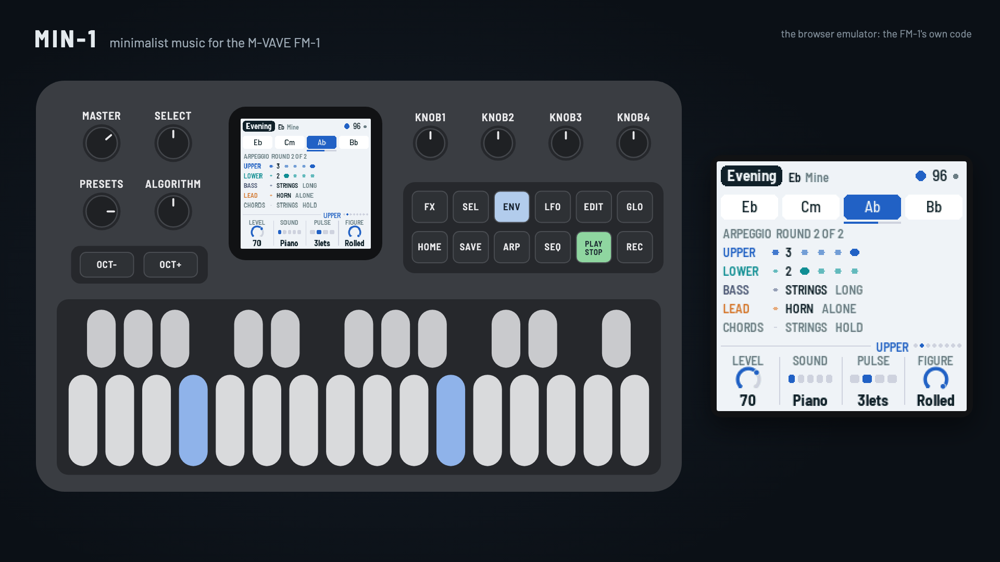
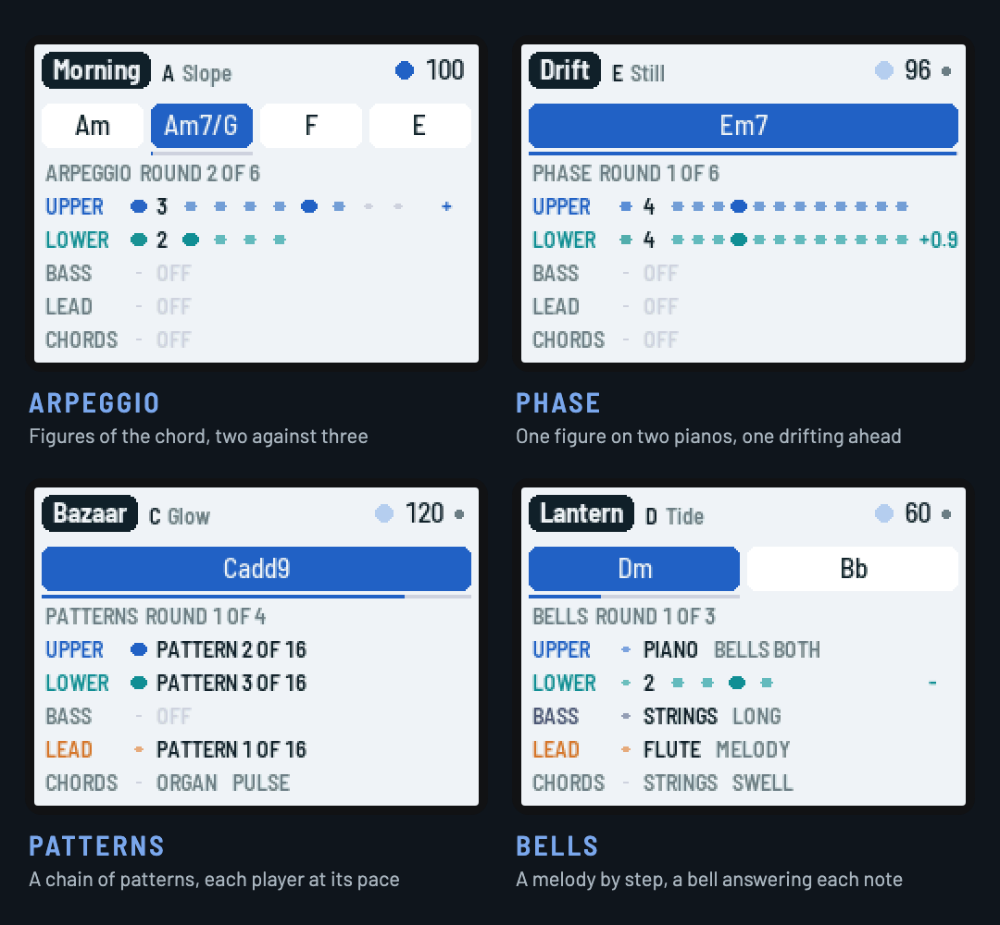

# MIN-1 for the M-VAVE FM-1

*Minimalist music for everyone, by Reytian. Inspired by [FM1-AMB](https://github.com/charlesvestal/fm1-amb) and Philip Glass.*



MIN-1 turns the M-VAVE FM-1 into a small minimalist ensemble, in the manner of the music of the 1960s to
80s that was made from very little: repeating figures, slow cycles of chords, processes you can hear.
It plays itself from the moment it's switched on, so there is always something to start from; then
you take over as much as you like: play your own chords (no theory needed: in EASY keys every key is a
chord that fits), roll ideas and keep the ones you like, bring parts in and out by hand, put processes
on the figures, and record it all as a song.

- **Try it in your browser** (no FM-1 needed): <https://reytian.github.io/fm1-min1/emu/>
- **Install it** (Chrome or Edge, with the FM-1 plugged in): <https://reytian.github.io/fm1-min1/install/>,
  or from the command line: `python3 tools/fm1_install.py min-0.2.1.fwsc` (see [BUILDING.md](BUILDING.md#install))
- **Download the firmware file**: [releases](https://github.com/Reytian/fm1-min1/releases) (`min-0.2.1.fwsc`)
- **Watch the demo** (3:49, recorded from the browser emulator, no voice-over):
  [min1-demo.mp4](https://github.com/Reytian/fm1-min1/releases/download/v0.2/min1-demo.mp4)

## Four models



| Model | What it does | Pieces |
|---|---|---|
| ARPEGGIO | Figures of the chord's tones, two against three; the additive process grows and shrinks them a note at a time | Morning, Glacier, Lagoon, Machine, Skyline, Evening, Counting, Prism |
| PHASE | Two parts play one figure; the lower slowly drifts ahead, locks in a step ahead, drifts on, round to unison | Drift, Breath, Weave, Tilt |
| PATTERNS | A chain of short patterns, each a little changed from the last; three players move along it at their own pace over a high pulse | Bazaar, Field, Gears, Murmur |
| BELLS | A melody walks the scale by step in phrases that grow from one note; a bell answers each note with the chord's nearest tone | Vigil, Snowfall, Lantern, Chapel |

## In short

| | |
|---|---|
| Keys | The chord. EASY (the default): each white key is a chord of the key, the tonic leftmost; the black keys the same chord with a seventh; several keys make a richer one. NOTES: the notes themselves. Let go and the cycle comes back |
| PLAY · REC · EDIT | Play / stop · record a song from the top (again: kept) · an idea for this page |
| SEL held | By hand: ENV ARP LFO SEQ FX bring a part in or out; EDIT goes back to the idea before; REC learns a cycle from the chords you play; PLAY switches songs / live; white keys 1–8: grow, shrink, shift, flip, still, slower, faster, a new section |
| HOME · ENV · ARP · LFO · SEQ · FX · GLO | The pages: Form, Upper, Lower, Bass, Lead, Chords, Setup (GLO again: System) |
| SELECT | The previous or next page; with HOME held, the tempo |
| ALGORITHM · PRESETS | The chord cycle (eighteen, Mine, Rolled) · the piece (twenty), or in SONGS the song (eight) |
| OCT− / OCT+ | The upper part's octave |
| SAVE | Saves pieces and songs; held, puts the piece back to its recipe (in SONGS: deletes the song) |

Hold any button for a second and a card says what it does; hold SEL and the screen shows its map. The
design (in Chinese) is in [docs/DESIGN.md](docs/DESIGN.md).

### From listening to making

1. **Listen.** PRESETS goes through the twenty pieces; each plays itself.
2. **Play the harmony.** Press white keys: each is a chord that fits. Turn HOLD on (Setup) and a chord
   stays until you press it again. The keys light where the cycle is, so you can play along.
3. **Roll ideas.** On a page, EDIT rolls an idea for it: a new chord cycle (Form), a new figure (Upper,
   Lower), a new line or melody or set of patterns (Lead), a new bass, a new rhythm. SEL + EDIT goes
   back. Ideas are kept with the piece.
4. **Make your own cycle.** SEL + REC, play two to eight chords one at a time, REC: they become "Mine".
5. **Arrange by hand.** SEL + a part's page button brings it in or out at the next chord; SEL + white
   keys put processes on the figures.
6. **Record a song.** REC starts from the top and records everything you do; REC again keeps it. PLAY
   plays it back exactly. SAVE keeps it, eight songs in all.

### The pages

| Page | KNOB 1 | KNOB 2 | KNOB 3 | KNOB 4 |
|---|---|---|---|---|
| Form (HOME) | Evolve (Patterns: Move on) | Build | Process (Phase: Drift, Patterns: Spread, Bells: Phrases) | Chord (its length) |
| Upper (ENV) | Level | Sound | Pulse (notes a beat) | Figure (Patterns: Start, Bells: where the bells answer) |
| Lower (ARP) | Level | Sound | Pulse | Figure (Patterns: Start) |
| Bass (LFO) | Level | Sound | Style | Octave |
| Lead (SEQ) | Level | Sound | Activity (Patterns, Bells: Pace) | Harmony |
| Chords (FX) | Level | Sound | Rhythm (hold, swell, 8ths, beats, breath, pulse) | Room (the reverb) |
| Setup (GLO) | Tempo | Root | Keys (Easy / Notes) | Hold |
| System (GLO again) | Model | MIDI out | Lights | CPU |

## Building and testing

The toolchain is AMB-1's and X0X's (see [BUILDING.md](BUILDING.md)):

```
tests/run_tests.sh      # the instrument, the platform pieces, the app in a simulator, the load on the FM-1
./build.sh              # build/min.fwsc
python3 tools/fm1_install.py build/min.fwsc     # install it over USB
```

`build/host/min_host SCRIPT OUTDIR` runs the whole app on a computer from a script
(`tests/scenarios/*.min`), with audio and screenshots coming out. `tests/host/min_render.c` renders
every piece to `build/render/` and prints how hard each would work the FM-1's processor, from the
instructions it runs (calibrated against X0X's published PERF TEST figures).

Installing firmware is at your own risk. An FM-1 that fails to start twice comes up in a safe mode with
USB on, and M-VAVE's own firmware can always be put back: the web installer's "Back to the stock
firmware", or see BUILDING.md.

## Credits

MIN-1 is by Reytian. It is inspired by [AMB-1](https://github.com/charlesvestal/fm1-amb), Charles Vestal's
generative ambient firmware for the FM-1, and by the music of Philip Glass.

The platform (hardware layer, USB, update loader, storage, installer) is [Felucca](https://github.com/hugelton/Felucca)'s
by Leo Kuroshita (Hügelton Instruments), by way of Charles Vestal's [X0X](https://github.com/charlesvestal/fm1-x0x),
FoMni and [AMB-1](https://github.com/charlesvestal/fm1-amb), whose app layer, simulator and tools MIN-1 started from.
The reverb is Jon Dattorro's plate ("Effect Design, Part 1", JAES 1997), as in AMB-1. The models follow
techniques of the minimalist composers (arpeggiated cycles and additive process, phasing, chains of
patterns played at each player's pace, tintinnabuli); no music is taken from their works. GPL-3.0-only;
see [LICENSING.md](LICENSING.md).

M-VAVE and FM-1 are trademarks of their owners. MIN-1 is not affiliated with M-VAVE, Hügelton
Instruments, Charles Vestal, Philip Glass, or any composer.

## 中文简介

MIN-1 是 M-VAVE FM-1 的极简主义音乐固件，受 FM1-AMB 与 Philip Glass 启发。开机就自己演奏：重复的音型、
缓慢的和弦循环、听得见的过程；然后交给你：按住白键就是和弦（不需要乐理），EDIT 随机出点子，教它你自己的和弦循环，
亲手让声部进出，录下一首歌并原样回放。四种模型（琶音、相位、模式、钟声），二十首曲子。设计说明见
[docs/DESIGN.md](docs/DESIGN.md)。在浏览器里试玩：<https://reytian.github.io/fm1-min1/emu/>；
用 Chrome 或 Edge 安装：<https://reytian.github.io/fm1-min1/install/>。
